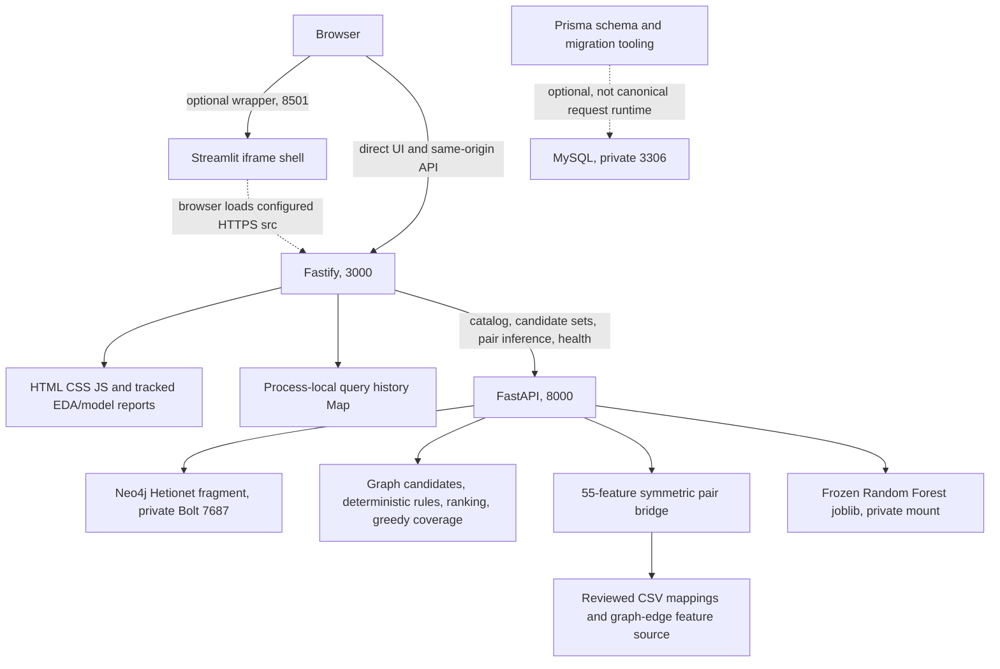

# PolyMerge final project audit

Audit date: 2026-10-15, Asia/Manila. Scope: research prototype, not clinical certification. Scores are reviewer judgments, not scientific measurements.

## Executive summary

**PARTIAL: local research demonstration works; public staging is blocked. Project 71/100, deployment readiness 42/100, supervised demo readiness 76/100.**

The strongest properties are real, traceable graph evidence, a checksum-verified frozen classifier, explicit unavailable states and a substantially improved frontend. The largest gaps are ineffective hard-rule matching for canonical graph IDs, unauthenticated shared history, expensive blocking generation, dependency advisories, and missing browser acceptance. A separately reproduced optimizer union-rule defect was fixed with a focused regression test during this audit. No new clinical mapping/rules were invented.

CI, three non-root application Dockerfiles, private-loopback Compose, a disabled reviewed-host deployment template, release metadata checks and smoke procedures are prepared. This is not a deployment approval. No public infrastructure, DNS, billing, database changes, model publication, retraining or final test evaluation occurred.

## Repository evidence

- Audited application base: `sprint6/jared/frontend-flow-repair`, `aab84a4709302117062e14ef78d77dc815b7cb3c`.
- Prior verified commit: `c10e319f2da4d867e654b380bfa54e4180e3923f`.
- Reviewed intervening commit `aab84a4`: six files, 403 insertions/24 deletions, top-ten display, full counts, reset/abort/stale-response protection, glossary and grounded conclusions, clearer model labels and behavioral tests.
- Fetched `origin/main`: `2edcc39bfe83296b00020e9d7894aa3d95889754`, a merge of an earlier frontend-repair revision. `git rev-list --left-right --count origin/main...HEAD` at the base returned `1 5`. No main changes were discarded or merged.
- Clean worktree before creating `sprint6/jared/final-audit-cicd` from the validated latest frontend branch. This audit's infrastructure/fix commits descend from that base, not stale main.
- Evidence commits: `4d61992` infrastructure/checks; `26fc743` clean-checkout source testing and container liveness; `b457d17` optimizer union guard. Final report/CI evidence is in subsequent commits on the same branch. No PR was opened.

## Actual architecture

Evidence: `backend/src/server.js`, `ml_engine/main.py`, `ml_engine/app/services/{graph_service,candidate_generator,candidate_ranker,set_cover_optimizer,ddi_feature_builder,model_serving}.py`, `streamlit_app.py`, `backend/prisma/schema.prisma`.

Startup order: provision/verify private graph and model -> FastAPI (startup attempts model load, absence degrades inference rather than liveness) -> Fastify -> optional Streamlit. Fastify serves static pages and forwards canonical requests. FastAPI performs synchronous Neo4j/feature/model work inside async handlers. MySQL is not used for canonical query/history persistence despite existing Prisma tooling. JWT_SECRET exists in the example but does not implement authentication. Legacy demo endpoints still exist.

Local tested services: Fastify 3002, ML 8000, Streamlit 8503; those are local overrides, not deployment defaults. Environment variable names, private network setup, ports and startup checks are enumerated in [DEPLOYMENT_GUIDE](../deployment/DEPLOYMENT_GUIDE.md).

## Findings by severity

| ID | Severity/status | Evidence and consequence | Required next action |
| --- | --- | --- | --- |
| SEC-1 | BLOCKER for public access, open | `backend/src/server.js:165`, `:815`, `:933`: unauthenticated shared, unbounded history; no per-user isolation/TTL. All users can enumerate retained queries; memory grows and restart loses state | Authenticate or restrict staging at a trusted gateway; scope/expire history; enforce resource limits |
| SEC-2 | HIGH / release blocker, open | npm audit: 2 high vulnerable packages, Fastify and fast-uri. Python 3.9 audit: 39 advisories/10 resolved packages; hosted Python 3.11: 10/4. Includes old Starlette, scikit-learn, dotenv and pytest | Review applicability, patch supported dependencies with regression checks, isolate frozen-model compatibility review; no blanket suppressions |
| RULE-1 | HIGH, open | `ml_engine/app/services/safety_filter.py:12`, `backend/src/rules/contraindications.js:7`, generator passes canonical `Compound::...` IDs. Literal rule tokens (`maoi`, `ssri`, etc.) cannot match those IDs; no mapping stage | Reviewed identifier/class mapping, explicit unsupported-rule coverage state, realistic graph-ID tests. Do not infer comprehensive safety from accepted status |
| PERF-1 | HIGH, open | `candidate_generator.py:108` materializes all combinations before slicing; config allows up to 10 drugs/set, 500 returned sets. `main.py:355` blocks event loop. Live two-disease request ~58s; concurrent health 503 after 5s | Bound work before enumeration; background job/admission control; separate liveness, cancellation/dedup, representative concurrency tests |
| RULE-2 | HIGH, fixed here | `set_cover_optimizer.py:94`: accepted sets could merge into a prohibited union. Synthetic `maoi` + `ssri` reproduced this | Added union check to eligibility and `test_candidate_set_optimizer_checks_rules_across_merged_sets`; safe alternative/uncovered cases pass. Does not fix RULE-1 |
| API-1 | MEDIUM, open | `candidate_generator.py:49`: query ID uses whole seconds; backend Map keys can collide. No request idempotency; repeated calls recompute; abort does not stop server work | UUID/opaque unique ID, request ownership, bounded dedup/jobs |
| API-2 | MEDIUM, open | `backend/src/server.js:671` legacy drug interactions return constant predicted score 0.18 from demo data, outside canonical workflow | Disable legacy demo routes in staging or clearly isolate from research API; do not claim the entire API contains only real predictions |
| SEC-3 | HIGH if reused remotely, open | Root `docker-compose.yml` contains weak development credentials and wildcard DB port bindings | Never deploy it; use private provisioned DBs. New application Compose has no DB services and loopback-only published ports |
| SEC-4 | MEDIUM, open | Fastify CORS defaults to reflective `true`; ML broad CORS; no app CSP/frame restriction; client error messages include upstream details | Explicit origin policy, gateway authentication/rate limits, reviewed frame-ancestors, redact external errors, keep ML health private |
| REP-1 | MEDIUM, partially fixed | Clean-checkout ML suite originally failed because ignored raw DDInter files were absent; Python transitive dependencies/Streamlit range and base tags are not immutable | External-source test now explicitly skips only when all downloads absent; synthetic checksum/schema test always runs. Still lock reviewed runtime dependencies and image digests |
| UX-1 | MEDIUM, open | No available browser runtime; no viewport, screenshot, screen reader, keyboard-flow or measured contrast acceptance | Perform actual desktop/mobile and iframe QA before staging signoff |
| OBS-1 | LOW, open | Health checks do not establish graph authenticity, model quality, user isolation or MySQL availability. HTTP shell checks do not prove iframe renders | Separate liveness/readiness, keep real query smoke and browser acceptance |
| DOC-1 | LOW, open | Stale GNN language in contraindication comments, legacy rank tie-break reads synergyScore though canonical value is null | Remove obsolete terminology/compatibility after API review; no unsupported new model claims |

No confirmed credential compromise or critical exploit was established. Public-exposure blockers are real even though this is an academic prototype. Dependency scanner output is a triage finding, not proof every advisory is exploitable in this application.

## Functional and API acceptance

| Acceptance | Status | Evidence / boundary |
| --- | --- | --- |
| Home/navigation/Simulation/Explainability/Model Analysis structure | PASS (code/tests) | `backend/tests/frontend-static.test.js`; canonical sections and model report assets |
| Live disease catalog and single/multiple selection | PASS | 25 real catalog entries; frontend search/selection tests; one/two-disease real requests |
| Initial result limit and full counts | PASS | 10 visible by default, show-all optional; retained response/ranks/100-count summary unchanged; test `default display limits cards to ten...` |
| Reset and second simulation, stale success/error/finally | PASS (behavioral tests) | Generation token plus AbortController; tests in frontend-static cover completed/in-flight reset, late callback suppression and catalog retry |
| Loading feedback | PARTIAL | Honest elapsed/wait state, no fake server progress; latency still high; no actual server cancellation |
| Home disclaimer/model labels | PASS (code/tests) | Single footer disclaimer, visible Random Forest label; technical exact version retained |
| Candidate generation/ranking | PASS for represented coverage ordering | Stable repeated-input tests and live requests; no clinical ordering claim |
| Configured rules against real graph identities | FAIL | RULE-1. Synthetic literal-label rules pass; that is not real identifier coverage |
| Coverage optimizer | PARTIAL | Greedy accepted-set coverage, union-rule bug fixed; bounded returned pool, not globally optimal or clinical |
| Canonical graph evidence | PASS | Actual Neo4j counts, CtD/path/provenance tests, live smoke hashes |
| Applied/unavailable ML and malformed inputs | PASS | Model-serving, feature-builder, backend integration tests plus 32/93 live applied candidate counts |
| Graph dependency failure | PASS (tests) | Explicit empty candidate fallback; no fabricated canonical candidate or severity. Response can be HTTP 200 with unavailable metadata, so status alone is insufficient |
| Explain formats/missing candidate query | PASS (tests) | `backend/tests/ml-integration.test.js` invalid format/unknown query cases; separate graph/rules/ML channels |
| Model Analysis and EDA | PASS (HTTP/code/tests) | Preserved metrics, four tracked SVGs; no recomputation |
| Streamlit wrapper configuration/liveness | PASS | AppTest iframe src points to local3002; shell and `_stcore/health` pass |
| Browser visual/mobile/keyboard/iframe acceptance | NOT TESTED | Browser connection reported no available browser; HTTP/AppTest are not substitutes |
| Public staging/production | NOT TESTED / blocked | No target or deployment authorization |

Canonical endpoints: `GET /api/diseases`, `POST /api/candidate-sets/search`, `GET /api/model-comparison`, `GET /api/candidate-sets/:id/explain`, Fastify `/health` and `/health/dependencies`; ML `/health`, `/health/model`, `/api/diseases`, `/predict/candidate-sets`, `/predict/ddi-severity`. Validation rejects malformed objects, unknown disease IDs, invalid config and bad feature schemas. Backend health checks ML liveness, not SQL or all graph/model dependencies. Legacy `/api/combinations/*`, drug demo routes and global `/api/history` remain exposed.

Frontend external values are escaped by `escapeHtml`/`escapeExplanation`; generated SVG/HTML paths have escaping regression tests. This is evidence of specific XSS defenses, not a complete penetration test. No live attack/stress testing was conducted.

## Graph integrity

Read-only live Cypher counts:

| Nodes | Count | Relationships | Count |
| --- | ---: | --- | ---: |
| Disease | 25 | CtD | 142 |
| Compound | 299 | CbG | 1010 |
| Gene | 1411 | CuG | 977 |
| Side Effect | 1643 | CdG | 1484 |
| Pharmacologic Class | 37 | CcSE | 11987 |
| | | CrC | 519 |
| | | CpD / PCiC | 20 / 91 |

CtD means compound treats disease; CbG binds gene; CuG upregulates gene; CdG downregulates gene; CcSE causes side effect. CrC is compound resemblance, never a DDI label or rendered DDI evidence. It can be a graph-context feature, distinct from DDInter severity labels. Evidence paths allow only CtD/CbG/CuG/CdG/CcSE. Their IDs hash source, compound ID, relationship, target ID and graph version; smoke independently recomputes them. Source is Hetionet, graph version `Hetionet v1.0 filtered PolyMerge fragment`.

Disease IDs used live: `Disease::DOID:10763`, `Disease::DOID:9352`; compound IDs remain `Compound::DB...`. Queries use parameters, with validated/quoted identifiers for graph import helpers. Tests prove coverage has corresponding CtD paths, version-sensitive stable path IDs and no CrC evidence. Missing relationships are not invented. Counts and returned provenance do not independently validate every underlying biomedical source claim or ensure the fragment is complete/current.

## Candidate and optimizer semantics

GraphService retrieves compounds with represented CtD edges to selected diseases, plus bounded gene/side-effect context. Generation deduplicates drug IDs, enumerates combinations of sizes 1 through maxDrugCount (default3), constructs evidence and rule status, then sorts accepted before rejected, greater selected-disease coverage, fewer drugs, candidate ID; finally caps returned candidates (default100). The cap is not an enumeration-work budget. The returned list is not exhaustive across all drugs or combinations. Evidence context limits also mean it is not a complete side-effect profile.

Coverage is the union of represented treatedDiseaseIds intersected with selected diseases divided by selected-disease count. It is not efficacy. Ranker sorts status/coverage/drug count, with an obsolete synergy tie-break that is null in canonical generation; stable sorting retains prior candidate-ID order. Severity is attached after ranking/optimization and does not rerank. Backend can add rejection without reranking. Same normalized graph result is deterministic; candidate IDs concatenate incoming drug order, so arbitrary input permutations to the generator are not guaranteed canonicalized. Graph query name ties lack an explicit ID secondary order, a low-priority determinism edge case.

Optimizer works on that capped accepted pool, selecting maximal newly covered diseases, then coverage, then fewer drugs, with input order breaking ties. It stops at coverage threshold (default0.8), merged-drug limit (default5) or no new coverage. Its selected subset/union is distinct from the full ranked list. The audit fix checks the merged union against configured rules before selection. It is still a greedy baseline, not a global optimum, clinical recommendation or validation of combined formulation.

## Frozen ML integrity

File `models/sprint5/random_forest_ddi_pipeline.joblib` measured **251404304 bytes**, SHA-256 **2b9ed9ca9a57a3eed256eb28d369df89403666a1c5ea1231c47ebe1e053ccc6d**, version **RandomForestClassifier-sprint5-v1-65e9834666ad19c5**. No modification, retraining, tuning or final evaluation performed.

`model_serving.py` verifies size/hash before deserializing, contract hash, deterministic version and pipeline shape, then validates exact finite 55-feature inputs. PairFeatureBuilder uses reviewed exact-name Hetionet/DDInter and structure mappings, symmetric graph/molecular features and explicit missingness. Unsupported mapping/structure pairs remain not_applied; single-drug candidates are not applicable. Major/Moderate/Minor are severity classes, not probabilities or clinical truth. Unit tests cover missing/corrupt artifact, checksum mismatch before deserialization, malformed schema, pair-order invariance and supported inference.

Canonical live smoke rejects nested confidence/probability/safetyScore/combinedSafetyScore fields and requires deterministic paths plus a real frozen-version applied pair. `interactionRisk` and `synergyScore` remain null compatibility keys, not invented numeric scores. Do not generalize this assurance to legacy demo interactions (API-2). Joblib must come from a trusted private source; hashes are not digital signatures.

## Scientific validity and claims

Authoritative tracked sources: `docs/sprint4-model-comparison.md`, `docs/sprint5-final-model-evaluation.md`, `data/interim/sprint5/final_model_evaluation.json`. Displayed values agree at shown precision: validation Macro F1 **0.506086 +/- 0.005695**, final Macro F1 **0.524630**, balanced accuracy **0.475467**, macro AUROC **0.798793**, macro AUPRC **0.632468**. These were read, not recomputed.

The structural validator found 130422 rows, 104337 train/26085 test, zero canonical-pair overlap, 55 features, no excluded metadata in X. It fits preprocessing on train and transforms held-out rows only to validate structure, not classifier prediction/evaluation. 1768 of 1787 distinct test drugs (98.936766%) occur in training, limiting claims of novel-drug generalization. Secondary holdout structure is validated but no new evaluation was run.

Moderate labels dominate (96675/130422); Major26914, Minor6833. Preserved recall is Major0.243730, Minor0.202634, Moderate0.980036. A respectable AUROC does not erase weak minority-class recall. DDInter curation, mapping coverage, missing structures, fragment incompleteness and pair-level rather than multi-drug formulation labels constrain interpretation. No external clinical validation, dosage, pH, chemical/formulation compatibility, manufacturing validation, new-compound discovery or prescribing recommendation is established. Current core UI explains these boundaries; accepted-rule wording remains potentially over-reassuring until RULE-1 is resolved.

## UX judgment

The glossary and six-part grounded conclusion help a first-time student understand drug origin, graph coverage, rule outcome, pair severity and ranking. Ten initial cards reduce clutter while preserving full counts; per-pair severities avoid an invented aggregate safety label. Collapsible technical metadata is appropriate. Long repeated guide/conclusion blocks can still overwhelm; recommend concise default summaries with progressive disclosure and explicit rule-coverage limitations. Graph display is a constrained evidence view, not the full Neo4j network. Semantic buttons, focus-visible rules and responsive CSS exist; contrast, keyboard order, touch layout, focus after reset and actual iframe usability remain unverified visually. Do not award browser acceptance from VM fake-DOM tests.

## Security and deployment observations

Only `.env.example` is tracked among env/key/model artifact patterns checked; actual `.env` was not printed. This was not an exhaustive Git-history secret scan and is not a certificate of no historical leaks. Local development credentials are intentionally visible in root Compose; they must never be reused remotely. Runtime templates exclude `.env`, models and unnecessary raw data from build context, use non-root users, drop capabilities in Compose, mount model read-only and publish application ports only on loopback. No database ports need public exposure.

New CI is read-only and action-SHA pinned, never publishes images or downloads the frozen artifact, and requires no production services. Deployment template is disabled and gated to main plus exact-SHA successful CI and protected Environment approval. Public access requires authentication, rate limits, trusted TLS/frame policy and advisory triage first. Existing health/error details should not be public diagnostics. Dependency upgrades were deliberately not forced, especially across serialized scikit-learn versions.

## Performance evidence

Single-run local measurements, not percentiles or load guarantees. Existing services were reused; Docker builds and audit tooling were also active on the machine.

| Measurement | Observed |
| --- | --- |
| Catalog | 0.099s first audit request, 0.033-0.036s subsequent smoke |
| Hypertension query | 20.038s; HTTP200; real_graph; 100 candidates; 32 applied |
| Hypertension + type2 diabetes | 57.957s; HTTP200; real_graph; 100 candidates; 93 applied |
| Independent smoke two-disease query | 57.585s; path hashes and no-score contract passed |
| Concurrent dependency health | HTTP503 after 5.009s while ML was generating |
| Idle dependency health | ~0.006s in final smoke |
| Fresh Python process imports + verified model load | 1.378s; model component only, not whole-stack cold start |
| ML RSS sample during work | 258848 KiB (~253 MiB); not peak memory or capacity recommendation |
| Static assets | ~0.001s local HTTP; browser paint/loading NOT TESTED |
| Whole-stack cold boot/public cold start | NOT TESTED; live services were not restarted destructively |

Backend runtime candidate timeout150000ms, health5000ms, catalog10000ms. Client candidate timeout150000ms can race upstream timeout plus catalog overhead. Defaults differ when environment values are absent. Health stalls confirm sync processing occupies the worker; more workers duplicate model memory and do not bound exponential work. Reset invalidates client callbacks and aborts transport but does not cancel server computation. Recommendations: bounded admission/work, job queue/cancellation, pair-feature/prediction caching with provenance-aware keys, and separate readiness/liveness; benchmark changes without altering frozen research results.

## Test and CI evidence

- Base: backend **71 passed**, including **26 frontend tests**; ML **83 passed**, four httpx deprecation warnings.
- After audit test additions and optimizer fix: full local ML **85 passed**, four httpx warnings; fixture checksum/schema and merged-set rule regression added. Clean checkout omits one external-source integration test explicitly; local raw-source integrity test still executes.
- Sprint4 contract validator PASS; model hash/size PASS; frontend `node --check` both files PASS; whitespace check PASS; five deployment-check unit tests PASS.
- Streamlit AppTest PASS (configured iframe source); local HTTP smoke and explicit real inference smoke PASS. No model training or test.csv prediction/evaluation.
- `actionlint` 1.7.12 validated actual workflow and disabled template; `bash -n` and Compose `config --quiet` with nonsecret dummy settings PASS.
- Local Docker builds failed obtaining base metadata with Docker credential-session deadline errors, not application compile errors. Hosted Actions subsequently built all three Linux images successfully. No local container acceptance is claimed from that failure.
- First real [GitHub run 38612756910](https://github.com/AshenDary/PolyMerge/actions/runs/38612756910): all three builds PASS, backend PASS, ML82 pass/1 fail due to ignored raw source files, security FAIL (npm2 high, Python10 advisories/4 packages). Clean-checkout testing was corrected, not hidden by continue-on-error.
- Subsequent runs and final job outcomes are recorded in the completion evidence below. Security remains intentionally blocking until reviewed fixes land; YAML/actionlint validity is not a CI pass.
- [Run 38613343775](https://github.com/AshenDary/PolyMerge/actions/runs/38613343775): regression PASS (ML84 pass/1 external-source skip), ML/Streamlit container liveness PASS; backend startup caught missing feature-contract JSON in the new image. Dockerfile corrected to include it. Security remained FAIL. The superseded run38613232802 was cancelled by workflow concurrency.
- Gaps: real browser/E2E accessibility, meaningful concurrent load, independent DB-failure integration, authenticated history isolation, realistic rule-ID mapping and target-host model-ready container tests. Mocked graph/ML tests do not cover those completely.

## Weighted scorecard

| Category | Earned / max | Judgment, evidence, remaining severity and improvement |
| --- | ---: | --- |
| Architecture/code quality | 7/10 | Clear service boundaries and modular ML, but monolithic server, legacy routes, blocking async and duplicated rule literals; MEDIUM/HIGH. Separate runtime contracts/jobs and remove obsolete paths |
| Core functionality | 10/15 | Live catalog/generation/inference plus reset/display tests work; RULE-1 and shared history undermine completeness; HIGH. Add real identifier rules and bounded owned history |
| Knowledge graph integrity | 9/10 | Live counts, parameterized queries, deterministic provenance and CrC exclusion tests; MEDIUM incomplete source validation/fragment. Version snapshots and validate import coverage |
| Candidates/optimization | 7/10 | Transparent coverage ordering, accepted/rejected tests, fixed union-rule guard; HIGH combinatorial work, ineffective identity rules, capped greedy search. Bound enumeration and resolve rule mapping |
| ML integrity/reproducibility | 13/15 | Frozen hash/size/version, feature contracts, fail-closed and symmetry tests; MEDIUM unlocked runtime/advisories and limited mappings. Lock compatible runtime, document model trust/distribution |
| Explainability/scientific accuracy | 8/10 | Separate channels, honest preserved metrics and limitations; HIGH rule interpretation and MEDIUM legacy demo scores. Expose rule applicability explicitly, retire demo API |
| Frontend usability/accessibility | 7/10 | 26 behavioral tests, reset/top10/glossary improvements; MEDIUM no browser/accessibility evidence and verbose explanations. Real user/browser QA |
| Testing/reliability | 7/10 | Broad local suites, clean-checkout fixtures, live smoke and real CI; HIGH health blocking, MEDIUM integration gaps. Add realistic failure/concurrency/browser suites |
| Security/deployment | 3/10 | New gated CI/container/private model plan; BLOCKER no auth/history isolation and HIGH dependency advisories. Remediate before public access and rehearse release/rollback |
| **Total** | **71/100** | **PARTIAL academic prototype; not a clinical safety score** |

Deployment readiness **42/100**, separate operational rubric: reproducible build/CI12/20; access/dependency security4/25; private dependency/model provisioning8/20; monitoring/smoke/rollback10/20; target approval/browser acceptance8/15. Templates earn preparation credit, not live-deployment credit. Known public-access blockers override aggregate score.

Supervised demo readiness **76/100**, separate rubric: demonstrated core workflow27/30; explanation/scientific boundaries20/25; interaction/visual readiness14/20; latency/recovery10/15; operator setup5/10. This assumes local access, prepared model/graph, one user at a time and explicit disclosure of rule limits. It is not readiness for unattended public clinical use.

## Priority order and verdict

1. Keep public deployment disabled. Review dependency advisories and protect authentication/history/rate limits before exposure.
2. Resolve canonical drug-ID/class-rule coverage with reviewed biomedical mappings and integration tests; preserve honest unavailable-rule state.
3. Bound candidate work, handle asynchronous jobs/cancellation and verify health under concurrency. Replace second-resolution query IDs and bound history.
4. Finish transitive locking/image digests, trusted private model provisioning, graph snapshot/license review and target resource sizing.
5. Run actual desktop/mobile/iframe/accessibility acceptance, staging smoke and nondestructive rollback rehearsal. Only then seek final deployment approval.

Recommended hosting: paid always-on multi-service stack, private ML/Neo4j and optional Streamlit wrapper, not Community Cloud alone. Comparative official-source research, costs/uncertainty, secrets, model distribution, smoke and rollback are in [DEPLOYMENT_GUIDE](../deployment/DEPLOYMENT_GUIDE.md), [CI_CD](../deployment/CI_CD.md) and [RELEASE_CHECKLIST](../deployment/RELEASE_CHECKLIST.md).

Code is suitable for a review PR documenting remediation work, but not a green-CI merge or public staging release. Jared must approve hosting/budget and provide private configuration in a separate deployment task. No PR or deployment was opened automatically.

**POLYMERGE AUDIT PARTIAL - FIXES REQUIRED BEFORE DEPLOYMENT**
